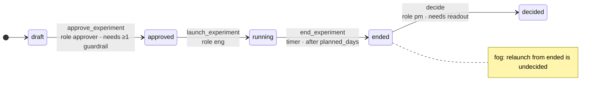
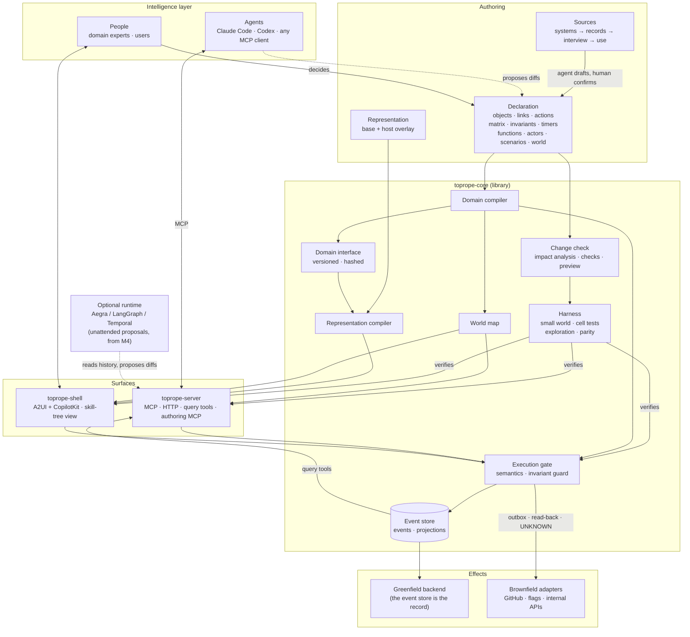

# Toprope

**A correctness layer and software factory for any stateful domain where people and agents act.**

Toprope is **designed to** capture a domain through an interview, often a workflow that
has only ever existed in people's heads, and turn it into a declared **world model**:
objects, actions, a transition matrix and invariants. From that model it is meant to
compile working software that people and agents both use, and to verify every allowed and
denied state transition before anything is deployed. Every action and decision is recorded
as an event, so the model can keep improving. Everything below describes the design.

> Status: **pre-M0, design only.** No code yet, and no claims are measured. See
> [Claim status](#claim-status).

---

## Why (where this started)

Toprope started from one problem, and it is the first one we test. Agents raised individual productivity, coding most of all. Organizational productivity did
not follow. The bottleneck moved to the work **between** people: getting code into the
product, or designing an experiment and moving a metric. That work runs on implicit, oral
process: who may approve, what must be true first, when a result counts.

- **Agents cannot automate what is not written down.**
- **Written-down rules in natural language cannot be checked.** Add a line to a skill or
  `AGENTS.md`, and nothing tells you whether it conflicts with the lines already there. You
  find out after deployment.
- **Decisions do not accumulate.** They are made in chats and meetings, so nobody can learn
  from them.

## Where it fits, and where it does not

The work between people is the starting point, not the boundary. Toprope applies wherever
there is **state, allowed actions and rules**, whoever acts:

| Who acts | Example |
|---|---|
| people ↔ people | approving and launching an experiment, shipping a change across teams |
| people ↔ agents | an agent does the work, and people step in only at approval points |
| agents ↔ agents | agent pipelines with no human in the loop, where the boundary and the record matter even more |
| end users ↔ a product | the backend of a consumer or business product built on state transitions: bookings, orders, subscriptions |
| one person | a personal tool with real states and rules |

It fits poorly where there is little to declare: one-off generation with no state,
open-ended creative work, and tasks whose success cannot be defined. Without a transition
matrix and invariants, the harness has nothing to check.

The research stays narrow even though the positioning is broad. The first domains are
Toprope itself and an experiment lifecycle. Only ⑥ is specific to work between people.
Claims ① to ⑤ are about any declared domain.

## The bet

**Nobody can define a domain correctly in one go.** A domain is found by iterating. So
the system must make each iteration cheap, safe and testable. Once the domain is declared
precisely enough, writing the code is nearly free.

That last sentence comes from the researcher's experience building with DDD and coding
agents. With a well-defined domain, a transition matrix and invariants, generated code that
passes a harness checking **every allowed state transition**, not just a call graph, has
had almost no problems in production. This is *observed, not measured*. Toprope exists to
measure it.

## How it works

```
 Intelligence   agents (Claude Code, Codex, any MCP client) and people
       │        see the world model and its allowed boundary
       ▼
 Toprope        declaration ─► compiler ─► MCP · UI · backend · query tools · harness
 correctness    Execution gate: matrix + roles + preconditions + invariant guard
 layer          event store: every action, decision, denial and outcome
       │        only allowed actions pass
       ▼
 Effects        greenfield: the backend Toprope generates
                brownfield: existing servers, APIs, DBs behind adapters
```

### 1. Interview → declaration
An agent drafts the domain from what already exists. The sources are used in order of how
easily they can be automated: **systems** (code, schema, APIs), then **records** (docs,
issues, chats), then an **interview** with the domain owner, then **use**.

The expert never has to think in matrices. The interviewer turns undecided cells and
candidate invariants into plain questions, such as *"Can someone approve an experiment
that is already running?"*. Every element records where it came from and whether a human
confirmed it. Agents only propose; humans confirm.

### 2. Declaration → software
One declaration compiles into:
- an **MCP server** for agents, with typed actions whose descriptions and denial reasons
  come from the model
- a **greenfield backend**: a domain API over an event store
- a **UI** for people, generated from a separately versioned *representation* layer that
  hosts can override with their own components
- **read-only query tools** over the event history
- a **harness** (below).

### 3. The harness checks the whole matrix
From the transition matrix, the invariants and a **small world** grown from the expert's
examples, the compiler generates:
- a test for **every** (state × action × role) cell
- invariant checks after every step
- bounded exploration that finds invariant-breaking sequences and reports them as minimal
  flows
- the expert's own example flows.

All of it runs against the model, the Execution gate, the MCP server, the UI and the
adapters. The same test must give the same answer on every surface.

### 4. Change safely, and fast
Every edit first gets an **impact report** in domain terms, before anything runs. For
example: *"changes 2 cells; affects 14 cell tests, 1 invariant, 2 views"*. Then the compiler
checks the affected set for:
- broken references
- conflicting rules
- example regressions
- what past events would have done under the new rules
- natural-language conflicts (warnings only).

The edit gets a **preview** to try before deploying. Only affected artifacts and tests are
rebuilt, and everything else comes from a hash-keyed cache. The draft targets are an
impact report in 2 s, an affected harness in 30 s, and a preview in 60 s.

### 5. Record everything, learn from it
Domain events are the system of record. Decisions (with inputs and rationale), **denied
attempts**, exceptions and effect outcomes are recorded too. Agents query this history to
propose the next domain change. A human decides, and the loop starts again.

### 6. See the whole world: the world map
The compiler also emits a **world map**, a skill-tree view of the domain (ADR-0020).
- Pick an actor and where an object stands. Unlocked actions light up, locked ones show
  exactly what would unlock them, and undecided cells sit in fog.
- Agents get the same map through MCP (`world_map`, `how_to_reach`).
- Every impact report includes the map diff: what a change newly unlocks or locks, and for
  whom.



## Components and relations

*Hand-drawn placeholder. If the M1 self domain declares Toprope's components as object types
and links, this diagram is replaced by the structure layer of its generated world map
(ADR-0020).*



How to read it:
- The **declaration** is the only source of each domain's software: the MCP, backend,
  views, harness and world map are generated per domain. `toprope-core` itself starts as a
  hand-built kernel (M0a). Self-compile moves more of Toprope into generated form over time.
  Function ports are always hand- or agent-written.
- Every action, from an agent or a person, passes the **Execution gate**, and it lands in
  the **event store**.
- The **harness** verifies the gate and every surface against the same declaration before
  a build can deploy.
- The loop closes when agents read the event history, propose a change to the declaration,
  and a person decides.

## A taste of the declaration

```yaml
transitions:                  # state × action → next state | deny(reason) | n/a | undecided
  Experiment:
    field: status
    matrix:
      draft:    {approve_experiment: approved, launch_experiment: {deny: "Launch requires approval."}}
      approved: {approve_experiment: {deny: "Already approved."}, launch_experiment: running}
      running:  {approve_experiment: {deny: "Only drafted experiments can be approved."}, launch_experiment: n/a}
      # ended and decided rows omitted here; see docs/domain-schema.md

invariants:
  - id: running-has-approver
    on: Experiment
    check: target.status not in ['running', 'ended', 'decided'] or exists(target.approved_by)
    reason: Nothing runs without someone having approved it.

scenarios:                    # the expert's examples, run on every surface
  - id: draft-to-running
    given: {from_world: E-onboarding}
    steps:
      - {actor: {role: eng},      do: launch_experiment,  target: E-onboarding, expect: {denied_by: matrix}}
      - {actor: {role: approver}, do: approve_experiment, target: E-onboarding, expect: {state: {E-onboarding.status: approved}}}
      - {actor: {role: eng},      do: launch_experiment,  target: E-onboarding, expect: {state: {E-onboarding.status: running}}}
```

Full schema: [`docs/domain-schema.md`](docs/domain-schema.md).

## How it differs

| | Natural-language skills (`SKILL.md`, `AGENTS.md`) | Ontology platforms | Toprope |
|---|---|---|---|
| Who authors | anyone, in prose | engineers, often deployed on site | domain experts through an interview, with agents drafting |
| Conflicts found | after deployment | at build time, by engineers | at compile time, reported in domain terms |
| Behavior verified | not mechanically | per project | designed to check every matrix cell and invariant on every surface |
| Cost of a change | a text edit, unchecked | an engineering project | an edit, an impact report, a preview |
| Agents | read text and hope | integrate via APIs | first-class users via generated MCP |
| Decisions | lost in chat | varies | event-sourced and queryable |

## What it is not

- Not an agent framework. The intelligence layer is whatever agent you use.
- Not a guardrail product. Enforcement follows from the model, but it is not the goal.
- Not a hosted multi-tenant service or a marketplace, for now.
- Not yet proven. Every claim below is untested until its milestone reports.

## The claim chain

The repository is organized around one premise and six claims. Each claim matters only if
the one before it holds.

```
P0 premise          nobody can define a domain correctly in one go; it is found by iterating
      ↓
① iterate safely    a domain can be changed cheaply and safely: breakage and conflicts are
                    caught at compile time and the change can be tried before deployment
      ↓
② model is right    through those iterations, the model comes to capture how the work runs
      ↓
③ works as built    software generated from a harness-passing declaration works in real use;
                    writing the code is nearly free (the software factory)
      ↓
④ shared language   MCP and UI generated from the model let people and agents act on the same meaning
      ↓
⑤ evolves           use accumulates decisions, and the model improves
      ↓
⑥ org productivity  handoff delay and re-explanation between people go down
```

## Claim status

| Link | Hypothesis | Verdict in | Status |
|---|---|---|---|
| ① iterate safely | H-Iterate | M1 (self), M2 (dogfood) | untested |
| ② model is right | H-Fidelity | M2 (an application domain whose expert is not Toprope's builder; ADR-0030) | untested |
| ③ works as built | H-Factory | M2 (dogfood use) | untested |
| ④ shared language | H-Shared | M3 | untested |
| ⑤ evolves | H-Evolve | M4 | untested |
| ⑥ org productivity | H-Handoff (partial) | M1 (self handoff, partial), M5 | untested |

Status values: `untested` · `supported` · `weakened` · `refuted`. The `Status` column
changes only in a PR that reports a preregistered experiment verdict.

## Roadmap

| Milestone | Link | What happens |
|---|---|---|
| M0a | none | Thin slice: semantics, model interpreter, Execution, event store, `toprope-server` MCP, authoring MCP, source readers, world map (JSON + MCP tools), harness, change check (incl. log replay and in-flight check), incremental analysis |
| M1 | ① ⑥ (partial) | **Self-compile**: model Toprope's own Authoring and Delivery workflows, generated end to end (ADR-0028); ② moves to M2 (ADR-0030); a natural-language skill vs. a structured spec without a compiler vs. Toprope, on a frozen change sequence with seeded conflicts |
| M0b | none | Surfaces and effects: representation compiler and shell, brownfield adapter (GitHub), embedded shape, migration plans, query tools, timers and functions |
| M2 | ① ② ③ | **Dogfood**: an application domain built with the self-compiled tool and used for real; ② needs an expert who is not Toprope's builder |
| M3 | ④ | Do agents make fewer meaning errors through the generated surfaces? |
| M4 | ⑤ | Proposals from the event history; humans decide (an optional runtime adapter, Aegra first, joins here) |
| M5 | ⑥ (partial) | Typed handoffs between domains; write-up; public release |

Details, exit criteria and kill criteria: [`docs/roadmap.md`](docs/roadmap.md).

## Stack

- **Domain core**: a Python library (`uv`). It never imports a runtime.
- **`toprope-server`**: the first deployment shape. It serves MCP for agents, HTTP for the
  greenfield API, and the query tools. It can also be imported as a library.
- **Drafting and interviewing**: done by your own agent (e.g. Claude Code) through the
  generated authoring MCP.
- **Optional runtime** for unattended workflows (from M4): [Aegra](https://github.com/aegra/aegra), behind a port.
- **UI** (`toprope-shell`): A2UI views compiled from the representation layer, rendered with React + CopilotKit.
- **Event store**: PostgreSQL in its own schema.
- **Harness exploration**: Hypothesis stateful testing.

## Documents

- [`docs/charter.md`](docs/charter.md): problem, what Toprope is, the chain, hypotheses, principles
- [`docs/roadmap.md`](docs/roadmap.md): milestones, each ending with a verdict on a link
- [`docs/architecture.md`](docs/architecture.md): layers, bounded contexts, ports and adapters, pipelines
- [`docs/domain-schema.md`](docs/domain-schema.md): the declaration format
- [`docs/experiments/M1-self-compile.md`](docs/experiments/M1-self-compile.md): the first experiment
- [`docs/adr/`](docs/adr/): every decision, with provenance and supersession
- [`notes/ko/`](notes/ko/): working notes in Korean

## Working here

Branching, PRs, merge methods and rules for coding agents are in [`AGENTS.md`](AGENTS.md).
In short: branch from `develop`, open a PR into `develop`, and name the link your change
serves.

Ground rules:
- Small, falsifiable milestones on an evenings-and-weekends budget (~10h+/week).
- Reuse OSS for everything that is not a link in the chain.
- Claims state their evidence level: *measured*, *observed once*, or *hypothesis*.
- Gold sets and seeded change lists are written by the researcher only.

## License

Not chosen yet. The repository stays private until M1 has a verdict. Apache-2.0 is the
proposal (ADR-0005).
