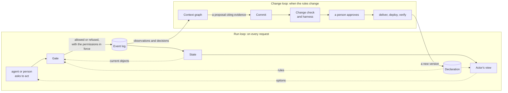

# Concepts: what Toprope is made of, and how the parts work together

Link: all. One page that names every part of Toprope, says what each one is in our own words,
whether it is **stored** or **computed when asked**, what it is responsible for, and how it
works with the others. Other pages go deeper on one part each; this one is the map. Terms used
elsewhere in the industry for similar things are in the [appendix](#appendix-industry-terms).
Built or planned: each part says so; the current state is in [`STATUS.md`](STATUS.md).

## The parts

| Part | What it is | Stored or computed | Responsible for | Built |
|---|---|---|---|---|
| **Declaration** (the world model) | the objects and links of one domain, the actions that change them, the functions that compute over them, and the rules and permissions over those: the transition matrix, preconditions, invariants, roles, actor rules, `requires: human` | stored, as commits | what exists and what is allowed | yes (functions: M0b) |
| **Event log** | everything that happened: each action, each refused attempt, each decision with its rationale, the permissions it ran under, each handoff and kernel call | stored, append-only | the record nothing else can recreate | yes |
| **State** | the objects as they are now: each one folded from its events | computed from the event log | what the gate checks against | yes |
| **Gate** (Execution) | the one check every action passes: the matrix cell, the actor's roles and principal, the preconditions, then the invariants on the result | computed on every request | refusing what is not allowed, with the declared reason, and recording the outcome | yes |
| **Actor's view** | what one actor may do to one object now, and how to reach what it may not yet: `allowed_actions`, the world map from that actor's position, `how_to_reach` | computed on every request | showing an agent or a person its options before it acts | yes |
| **Context graph** | why the declaration is as it is and what happened under it: sources and status on every element, the interview log, proposals not yet confirmed, decisions with their reasons, commits, approvals, check records, evidence | computed, as a view over stored records | explaining a rule, and proposing the next change | in part (one queryable graph: M0b) |
| **Change loop** | how a declaration changes: propose, commit, change check, a person approves by merging into the domain's `main`, deliver, deploy, verify | a procedure; each step is a recorded action of the Authoring and Delivery domains | the only way anything in the context graph becomes a rule or a permission | yes |
| **Change check** | the impact report and the checks a commit gets: broken references, conflicting rules, scenario regressions, what past events would have done, proposed elements still unconfirmed | computed per commit, recorded on it | showing what a change breaks before anyone approves it | yes (natural-language conflicts: no checker yet) |
| **Harness** | tests generated from the declaration: every state × action × role cell its examples reach, invariants after every step, bounded exploration, the expert's scenarios | generated per declaration | trusting generated software because the whole matrix is tested | yes (model, gate, MCP; UI and adapters: M0b) |
| **Surfaces** | what people and agents use, generated from the declaration: MCP tools, the command line, the guide, the world map | generated | acting through the gate, never around it | yes (UI, backend, query tools: M0b) |
| **Kernel** | the hand-built core every domain shares, and the rules no declaration can weaken: only a person approves or deploys, nothing deploys without a passing harness, nothing proposed reaches `main` | code | the guarantees a workflow designer does not have to build | yes |
| **Adapters** | the boundary to systems that already exist: the call, an idempotency key, and a read-back that decides whether the effect happened (`UNKNOWN` until it does) | code, per system | putting the gate in front of real systems | M0b |

## Two loops

Toprope runs two loops. One does the work; the other changes how the work is done.

- **The run loop** decides each action against the declaration and the state, records it, and
  updates the state and every actor's view. It never changes a rule.
- **The change loop** turns what was observed and decided into a rule, only through a reviewed
  commit. It never acts on the work itself.
- **They meet in two places**: the event log the run loop writes is what the change loop reads
  (through the context graph), and the declaration the change loop deploys is what the run loop
  enforces. Toprope's own Authoring and Delivery are declared domains, so the change loop is
  itself a run loop of those domains.

## Time

Every event records when it was recorded (`at`) and which version of the declaration decided it
(`domain_version`); a deployment records when each version went live. So "was this decided under
the rule in force then?" has an answer for a deployed domain, without a second clock on every
event (ADR-0042). The self domains have it too: they run their deployed commit (ADR-0045). Facts that come from outside will carry the time they were observed (adapters,
M0b); rules that take effect at a future date are not supported.

## How the parts depend on each other

- The **gate** needs the declaration and the state, and nothing else. It does not read the
  context graph: a reason, a source or a hypothesis never allows or refuses anything.
- **State** is never written directly. It changes only when the gate records an allowed action.
- The **actor's view** is the gate asked in advance: what would be allowed now, for this actor.
- The **context graph** is never enforced. It is how a person reviewing a change sees why, and
  where the next change is proposed from (by agents now, by the proposal engine from M4).
- The **change check and harness** compare two declarations, and replay past events against the
  new one; their results are recorded on the commit and go into the context graph.
- The **kernel** sits under all of it and holds what no declaration may weaken.

## Known gaps

Concepts that other work on agents and graphs relies on and Toprope does not have yet:
obligations (what must happen by when), the link from a goal to a decision to its outcome,
control of what an actor may read, whether a fact is still true, the time a fact held as
distinct from the time it was recorded, and resolving the same thing across systems. ADR-0042
decides where each goes and when.

## Appendix: industry terms

The same words mean different things in different writing. This table maps them to the parts
above; Toprope's definitions are the ones in this page.

| Term elsewhere | Usually means | In Toprope |
|---|---|---|
| ontology, semantic layer | concepts, terms and relations | the declaration's objects, links and glossary |
| knowledge graph | what exists: entities and relations | state, typed by the declaration |
| context graph (as a store of decision traces) | how things changed and why | the context graph |
| context graph (as a per-request view) | what the agent should see for this request | the actor's view |
| policies, guardrails, controls | what may be done | the declaration's rules and permissions, enforced by the gate |
| memory | what the system remembers between requests | the event log |
| decision traces, lineage | decisions with their inputs | `DecisionRecorded` events and the context graph |
| GraphRAG, retrieval | finding context for a model | the intelligence layer's job, not Toprope's |
| world model | how the domain works | the declaration (ADR-0011, ADR-0041) |
