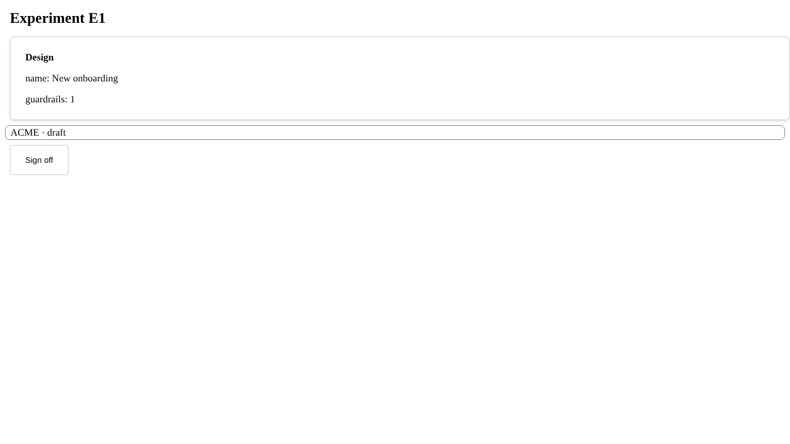

# M0 spike report

Link: none (enabler). Date: 2026-11-04. Code: [`spikes/m0/`](../../spikes/m0/). Scope is
ADR-0017 / roadmap M0a step 1: can `toprope-server` serve a declaration over MCP, and can
`toprope-shell` render a compiled representation with a host component, without an LLM?

## Verdict
**Both shapes work. ADR-0017 holds, and the A2UI fallback is not needed.** There were two
surprises: an MCP SDK major-version API change, and which package provides React basic
components. Both are recorded below.

## A. `toprope-server`: MCP tools generated from a declaration

What was built: a toy declaration (`toy.domain.yaml`) with two actions, a 3-state matrix, a
precondition, an invariant and fixtures. On top of it sit a tiny kernel implementing a
subset of `docs/semantics.md` and a server that **generates one MCP tool per declared
action** at startup, plus `get_object`, `world_map` and `history`.

| Check | Result |
|---|---|
| Tools generated from the declaration (name, typed params, description from `description` + roles + precondition reasons) | pass |
| In-process, **streamable HTTP** and **stdio** transports | pass, pass, pass |
| Denials carry domain reasons: `matrix` (launch in draft), `actor` (eng approving), `has-guardrails` (E2), `not-applicable` (launch while running) | pass |
| Allowed path draft → approved → running, with `approved_by` set and the invariant held | pass |
| Domain events (`ExperimentCreated/Approved/Launched`) separate from the attempts stream (3 `DeniedAttempt`, 1 `DecisionRecorded`) | pass |
| `world_map(role=eng)`: 6 edges; the only edge unlocked for eng is `approved → launch_experiment` | pass |

Findings:
- **`mcp` 2.x renamed FastMCP to `MCPServer`** (`mcp.server.mcpserver`) and changed other
  APIs. The kernel should depend on `mcp>=2.3,<3`, and the `AgentSurface` adapter should
  isolate the SDK, so the next major version is a one-file change.
- **Dynamic tools need a synthesized signature.** The SDK derives input schemas from Python
  signatures, so the generator builds `inspect.Signature` objects from declared params. It
  works. The real generator should emit JSON Schema directly if the SDK allows it, which is
  cleaner and has less magic.
- **Not covered in the spike:**
  - Identity is passed as tool arguments. The real server uses the `Identity` port with
    OIDC/JWT (ADR-0016).
  - `check` expressions use a restricted Python `eval`, which must be replaced by the
    declared expression language before M0a.
  - Storage is in memory.
  - Claude Code itself was not attached in this environment. Stdio was exercised with the
    MCP client, and the `claude mcp add` command is in `spikes/m0/README.md`.

## B. `toprope-shell`: compiled A2UI with a host component

What was built: a compiler (`toprope_spike/a2ui.py`) that turns a declared representation
plus a host overlay into **A2UI v0.9 messages**, deterministically. A React shell renders
them with no LLM and no CopilotKit runtime.

| Check | Result |
|---|---|
| Same inputs → byte-identical messages | pass |
| Overlay merged by section title (the *Status* section replaced by the host component; *Design* kept) | pass |
| Action buttons only for actions allowed for this actor in this state: approver sees one, eng sees none in `draft` | pass |
| Host alias applied to the label (`approve_experiment` → "Sign off") | pass |
| Host component `AcmeStatusBadge` rendered, bound to `/obj/status` | pass ("ACME · draft") |
| Clicking the button dispatches `userAction{name: approve_experiment, context: {target_id: E1}}` | pass |
| Console and page errors | none |

Findings:
- **`@a2ui/react` 0.15 ships no React basic components.** Its README pairs it with
  `@a2ui/web_core`'s web-component catalog. **`@copilotkit/a2ui-renderer` 1.84** provides a
  React `basicCatalog`, `createCatalog(..., {includeBasicCatalog: true})` for host
  components, and `A2UIProvider` / `A2UIRenderer`. It works **without** a CopilotKit runtime
  or an LLM. Use it as the `HumanSurface` adapter, and pin versions.
- A2UI has v0.8 and v0.9 protocol paths. Target **v0.9 only**, and keep the message
  compiler behind the `HumanSurface` port, so a protocol bump is contained.
- **Not covered in the spike:**
  - Routing the dispatched action to Execution and re-rendering. This needs the greenfield
    HTTP API (M0b).
  - Styling and theming.
  - CopilotKit chat/runtime features (not needed for declared views).

## Consequences
- ADR-0017's server-first plan and stack are confirmed. **Aegra is not needed** for either
  shape.
- Add to M0a:
  - pin `mcp>=2.3,<3`
  - the `AgentSurface` adapter isolates the SDK
  - the expression-language interpreter replaces `eval`.
- Add to M0b:
  - `HumanSurface` adapter on `@copilotkit/a2ui-renderer` (pinned), protocol v0.9
  - action dispatch → greenfield HTTP → Execution → re-render, covered by the UI-level
    harness parity checks.
