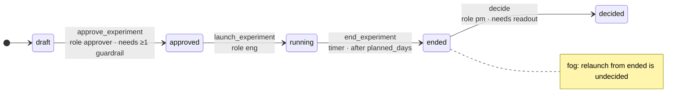
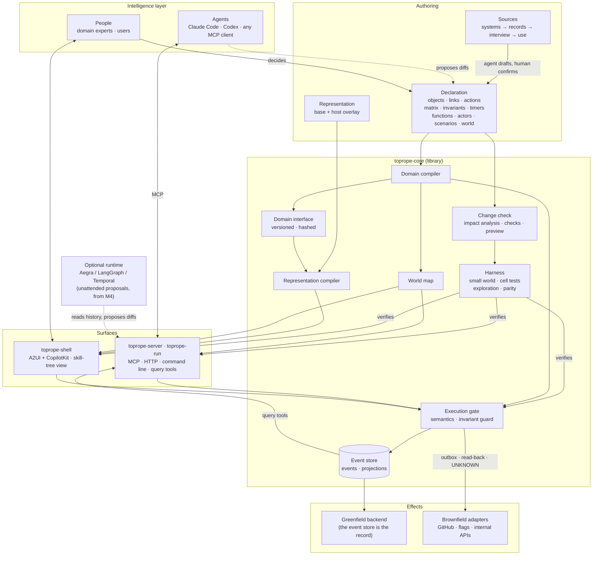

# How Toprope works

Link: ① ② ③ ④ ⑤ (what the design must deliver). Why it exists is in
[`problem.md`](problem.md); the design principles, claims and hypotheses are in
[`charter.md`](charter.md). This page walks through the pieces. Layers, ports and pipelines in
detail: [`architecture.md`](architecture.md). Everything here describes the design. Where a
part is not built yet, it says *planned* and names the milestone; the full picture is in
[`STATUS.md`](STATUS.md).

## The bet

**Nobody can define a domain correctly in one go.** A domain is found by iterating. So
the system must make each iteration cheap, safe and testable. Once the domain is declared
precisely enough, writing the code is nearly free.

That last sentence comes from the researcher's experience building with DDD and coding
agents. With a well-defined domain, a transition matrix and invariants, generated code that
passes a harness checking **every allowed state transition**, not just a call graph, has
had almost no problems in production. This is *observed* in the researcher's own projects,
*not measured*. It is link ③, a hypothesis until M2, and Toprope exists to measure it.

## The three layers

```
 Intelligence   agents (Claude Code, Codex, any MCP client) and people
       │        see the world model and its allowed boundary
       ▼
 Toprope        declaration ─► compiler ─► MCP · UI · backend · query tools · harness
 correctness    Execution gate: matrix + roles + preconditions + invariant guard
 layer          event store: every action, decision, denial and outcome
       │        only allowed actions pass
       ▼
 Effects        greenfield: the backend Toprope generates
                brownfield: existing servers, APIs, DBs behind adapters
```

### 1. Interview → declaration ([`domain-model.md`](domain-model.md))
An agent drafts the domain from what already exists. The sources are used in order of how
easily they can be automated: **systems** (code, schema, APIs), then **records** (docs,
issues, chats), then an **interview** with the domain owner, then **use**.

The expert never has to think in matrices. The interviewer turns undecided cells and
candidate invariants into plain questions, such as *"Can someone approve an experiment
that is already running?"*. Every element records where it came from and whether a human
confirmed it. Agents only propose; humans confirm.

### 2. Declaration → software
One declaration compiles into:
- an **MCP server** for agents, with typed actions whose descriptions and denial reasons
  come from the model
- a **greenfield backend**: a domain API over an event store (*planned*, M0b)
- a **UI** for people (*planned*, M0b), generated from a separately versioned *representation* layer that
  hosts can override with their own components
- **read-only query tools** over the event history (*planned*, M0b)
- a **command line** (`toprope-run`) and a **guide** for people (built, ADR-0036)
- a **harness** (below).

### 3. The harness checks the whole matrix ([`harness.md`](harness.md))
From the transition matrix, the invariants and a **small world** grown from the expert's
examples, the compiler generates:
- a test for **every** (state × action × role) cell
- invariant checks after every step
- bounded exploration that finds invariant-breaking sequences and reports them as minimal
  flows
- the expert's own example flows.

Today it runs against the model and the Execution gate. Running the same tests against the
MCP server, the UI and the adapters, with the same answer on every surface, is *planned* (M0b).

### 4. Change safely, and fast ([`change-check.md`](change-check.md))
Every edit first gets an **impact report** in domain terms, before anything runs. For
example: *"changes 2 cells; affects 14 cell tests, 1 invariant, 2 views"*. Then the compiler
checks the affected set for:
- broken references
- conflicting rules
- example regressions
- what past events would have done under the new rules
- natural-language conflicts (warnings only; the port exists, no checker is configured yet).

The edit gets a **preview** to try before deploying. Only affected artifacts and tests are
rebuilt, and everything else comes from a hash-keyed cache. The draft targets are an
impact report in 2 s, an affected harness in 30 s, and a preview in 30 s.

### Git and GitHub for the domain ([`commits.md`](commits.md))
Changes to a declaration are handled the way code is (ADR-0029, ADR-0032, ADR-0033):
- a change is a **commit** on a branch, content-addressed, with a **semantic diff**: only
  elements that changed directly are reviewed again
- the change check and the harness run on it, and their results are **recorded on the commit**
- a review comment is to become an **interview question**, and a review request a **decision
  request** to the person who may decide (decided in ADR-0032; *planned*)
- a person **approves by merging into `main`**; nobody approves their own change
- **Delivery** points an environment at one approved commit on `main`, and the deploy floor
  requires a passing harness.

Authoring and Delivery are themselves declared domains, so this whole loop is generated from
their declarations (self-compile, ADR-0028, ADR-0037).

### 5. Record everything, learn from it
Domain events are the system of record. Decisions (with inputs and rationale), **denied
attempts**, exceptions and effect outcomes are recorded too. Agents query this history to
propose the next domain change. A human decides, and the loop starts again.

### 6. See the whole world: the world map ([`world-map.md`](world-map.md))
The compiler also emits a **world map**, a skill-tree view of the domain (ADR-0020).
- Pick an actor and where an object stands. Unlocked actions light up, locked ones show
  exactly what would unlock them, and undecided cells sit in fog.
- Agents get the same map through MCP (`world_map`, `how_to_reach`).
- Every impact report is to include the map diff: what a change newly unlocks or locks, and
  for whom (*planned*, M0b).



## Components and relations

*Hand-drawn placeholder. If the M1 self domain declares Toprope's components as object types
and links, this diagram is replaced by the structure layer of its generated world map
(ADR-0020).*



How to read it:
- The **declaration** is the only source of each domain's software: the MCP, backend,
  views, harness and world map are generated per domain. Authoring and Delivery, the tools
  that make and ship domains, are declared domains too (self-compile, ADR-0037), so only the
  kernel in `toprope-core` is hand-built. Function ports are always hand- or agent-written.
- Every action, from an agent or a person, passes the **Execution gate**, and it lands in
  the **event store**.
- The **harness** verifies the gate and every surface against the same declaration before
  a build can deploy.
- The loop closes when agents read the event history, propose a change to the declaration,
  and a person decides.

## A taste of the declaration

```yaml
transitions:                  # state × action → next state | deny(reason) | n/a | undecided
  Experiment:
    field: status
    matrix:
      draft:    {approve_experiment: approved, launch_experiment: {deny: "Launch requires approval."}}
      approved: {approve_experiment: {deny: "Already approved."}, launch_experiment: running}
      running:  {approve_experiment: {deny: "Only drafted experiments can be approved."}, launch_experiment: n/a}
      # ended and decided rows omitted here; see docs/domain-schema.md

invariants:
  - id: running-has-approver
    on: Experiment
    check: target.status not in ['running', 'ended', 'decided'] or exists(target.approved_by)
    reason: Nothing runs without someone having approved it.

scenarios:                    # the expert's examples, run on every surface
  - id: draft-to-running
    given: {from_world: E-onboarding}
    steps:
      - {actor: {role: eng},      do: launch_experiment,  target: E-onboarding, expect: {denied_by: matrix}}
      - {actor: {role: approver}, do: approve_experiment, target: E-onboarding, expect: {state: {E-onboarding.status: approved}}}
      - {actor: {role: eng},      do: launch_experiment,  target: E-onboarding, expect: {state: {E-onboarding.status: running}}}
```

Full schema: [`domain-schema.md`](domain-schema.md).

## How it differs

Our reading of the alternatives, in broad strokes:

| | Natural-language skills (`SKILL.md`, `AGENTS.md`) | Rules engines, BPMN/DMN, policy-as-code | Ontology platforms | Toprope (design) |
|---|---|---|---|---|
| Who authors | anyone, in prose | engineers | engineers, often deployed on site | domain experts through an interview, with agents drafting |
| Conflicts found | after deployment | in tests of the rule set | at build time, by engineers | at compile time, reported in domain terms |
| Behavior verified | not mechanically | per rule set | per project | designed to check every matrix cell and invariant on every surface |
| Cost of a change | a text edit, unchecked | a code change | an engineering project | an edit, an impact report, a preview |
| Agents | read text and hope | call it as a decision service | integrate via APIs | first-class users via generated MCP |
| Decisions | lost in chat | decision logs, varies | varies | event-sourced and queryable |

Agent orchestration frameworks (LangGraph and others) are a different layer. In them you
engineer the **agent's** graph: which step the agent takes next. Toprope declares the
**domain's** graph: which moves are allowed at all. Any agent's graph, hand-built or generated,
runs inside it. An orchestration framework can be Toprope's optional runtime (from M4).

## Where it fits, and where it does not

The work between people is the starting point, not the boundary. Toprope applies wherever
there is **state, allowed actions and rules**, whoever acts:

| Who acts | Example |
|---|---|
| people ↔ people | approving and launching an experiment, shipping a change across teams |
| people ↔ agents | an agent does the work, and people step in only at approval points |
| agents ↔ agents | agent pipelines with no human in the loop, where the boundary and the record matter even more |
| end users ↔ a product | the backend of a consumer or business product built on state transitions: bookings, orders, subscriptions |
| one person | a personal tool with real states and rules |

It fits poorly where there is little to declare: one-off generation with no state,
open-ended creative work, and tasks whose success cannot be defined. Without a transition
matrix and invariants, the harness has nothing to check.

The research stays narrow even though the positioning is broad. The first domains are
Toprope itself and an experiment lifecycle. Only ⑥ is specific to work between people.
Claims ① to ⑤ are about any declared domain.
