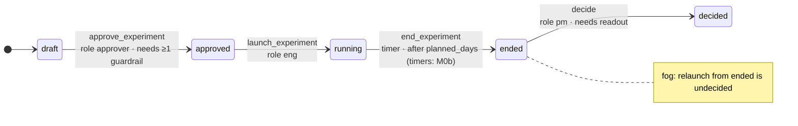
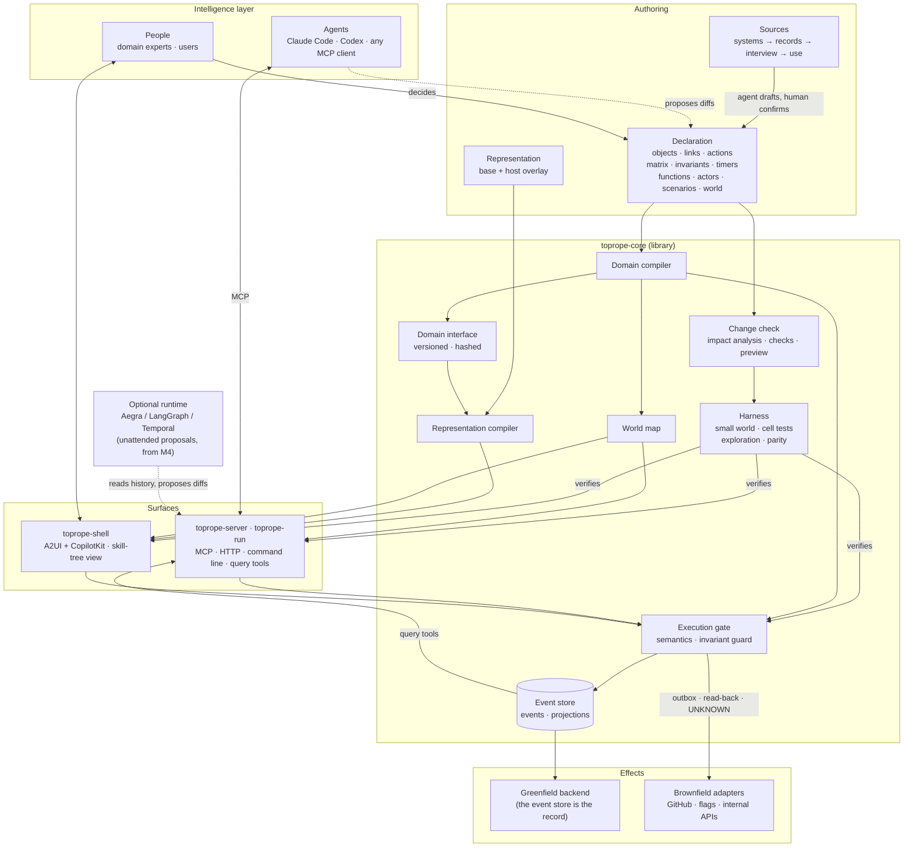

# How Toprope works

Link: ① ② ③ ④ ⑤ (the claims this design must deliver; [Terms](../README.md#terms) in the
README). Why it exists is in [`problem.md`](problem.md); the design principles, claims and
hypotheses are in [`charter.md`](charter.md). This page walks through the pieces. Layers, ports
and pipelines in detail: [`architecture.md`](architecture.md). Everything here describes the
design. Where a part is not built yet, it says *planned* and names the milestone; the full
picture is in [`STATUS.md`](STATUS.md).

## The bet

**Nobody can define a domain correctly in one go** (the premise, P0, taken as given). A domain
is found by iterating. So the system must make each iteration cheap, safe and testable. We
expect that once a domain is declared precisely enough, generated code becomes cheap to trust
and writing it nearly free; this is hypothesis ③, untested until M2.

That last sentence comes from the researcher's experience building with DDD and coding
agents. With a well-defined domain, a transition matrix and invariants, generated code that
passes a harness checking **every allowed state transition**, not just a call graph, has
had almost no problems in production. This is *observed* in the researcher's own projects,
*not measured*. It is link ③, a hypothesis until M2, and Toprope exists to measure it.

## Two graphs

A domain keeps two kinds of knowledge apart (ADR-0041, proposed): the **world model** says what exists and what may
happen, and is enforced; the **context graph** says why it is so and what happened, and is not.
The split follows kinds of knowledge that must not be mixed: an observation (what happened), a
memory (its record), an interpretation or hypothesis (what it may mean), a preference (a
tendency that depends on conditions), a rule (a condition accepted as binding) and a permission
(what one actor may do). Only the last two are enforced.

| Kind | Graph | Where it is in Toprope | Status |
|---|---|---|---|
| objects, links, actions, states | world model | the declaration | built |
| functions | world model | function ports (ADR-0015) | planned (M0b) |
| rules | world model | confirmed matrix cells, invariants, preconditions | built |
| permissions | world model | roles, actor rules, `requires: human`, grants (ADR-0016) | built |
| observations | context graph | domain events, refused attempts, effect outcomes | built; read-back from external systems M0b |
| memory | context graph | the event log, the interview log | built |
| interpretations, hypotheses | context graph | elements with `status: proposed` (only agents write them) | built; proposals from history M4 |
| decisions | context graph | `records_decision` events: who, when, inputs, rationale | built; expected outcome and re-review condition not yet |
| sources and history | context graph | `source` and `status` on every element; commits, approvals, check records | built |
| open questions and conflicts | context graph | `undecided` cells, `status: unknown` | built |
| preferences | context graph | — | not modeled |
| one queryable graph over all of it | context graph | query tools over the history | planned (M0b) |

**The one rule between them:** anything in the context graph becomes a rule or a permission in
the world model only through a reviewed change, a commit that passes its checks and a person
approves (ADR-0029, ADR-0033). Knowing a method, having adopted something as a default, and
approving this one action are different things. A proposal is never its own approval.

## The three layers

```
 Intelligence   agents (Claude Code, Codex, any MCP client) and people
       │        see the world model and its allowed boundary
       ▼
 Toprope        declaration ─► compiler ─► MCP · UI · backend · query tools · harness
 correctness    Execution gate: matrix + roles + preconditions + invariant guard
 layer          event store: every action, decision, denial and outcome
       │        only allowed actions pass
       ▼
 Effects        greenfield: the backend Toprope generates
                brownfield: existing servers, APIs, DBs behind adapters
```

### 1. Interview → declaration ([`domain-model.md`](domain-model.md))
An agent drafts the domain from what already exists. The sources are used in order of how
easily they can be automated: **systems** (code, schema, APIs), then **records** (docs,
issues, chats), then an **interview** with the domain owner, then **use**.

The expert never has to think in matrices. The interviewer turns undecided cells and
candidate invariants into plain questions, such as *"Can someone approve an experiment
that is already running?"*. Every element records where it came from and whether a human
confirmed it. Agents only propose; humans confirm.

### 2. Declaration → software
One declaration compiles into:
- an **MCP server** for agents, with typed actions whose descriptions and denial reasons
  come from the model
- a **greenfield backend**: a domain API over an event store (*planned*, M0b)
- a **UI** for people (*planned*, M0b), generated from a separately versioned
  *representation* layer that hosts can override with their own components
- **read-only query tools** over the event history (*planned*, M0b)
- a **command line** (`toprope-run`) and a **guide** for people (built, ADR-0036)
- a **harness** (below).

### 3. The harness checks the whole matrix ([`harness.md`](harness.md))
From the transition matrix, the invariants and a **small world** grown from the expert's
examples, the compiler generates:
- a test for each (state × action × role) cell its small world can reach; cells it cannot
  reach are reported
- invariant checks after every step
- bounded exploration that finds invariant-breaking sequences and reports them as minimal
  flows
- the expert's own example flows.

Today it runs against the model, the Execution gate and the MCP server, and checks *parity*:
the same test gives the same answer on each. The UI and adapter levels are *planned* (M0b).

### 4. Change safely, and fast ([`change-check.md`](change-check.md))
Every edit first gets an **impact report** in domain terms, before anything runs. For
example: *"changes 2 cells; affects 14 cell tests, 1 invariant, 2 views"*. Then the compiler
checks the affected set for:
- broken references
- conflicting rules
- example regressions
- what past events would have done under the new rules
- natural-language conflicts (warnings only; the port exists, no checker is configured yet).

The edit gets a **preview** to try before deploying. Only affected artifacts and tests are
rebuilt, and everything else comes from a hash-keyed cache. The draft targets are an
impact report in 2 s, an affected harness in 30 s, and a preview in 30 s.

### 5. Git and GitHub for the domain ([`commits.md`](commits.md))
Changes to a declaration are handled the way code is (ADR-0029, ADR-0032, ADR-0033):
- a change is a **commit** on a branch, content-addressed, with a **semantic diff**: only
  elements that changed directly are reviewed again
- the change check and the harness run on it, and their results are **recorded on the commit**
- a review comment is to become an **interview question**, and a review request a **decision
  request** to the person who may decide (decided in ADR-0032; *planned*)
- only a person **approves, by merging into `main`**, and only a commit whose checks passed;
  separate authors and approvers wait until a domain has more than one owner (ADR-0032)
- **Delivery** points an environment at one approved commit on `main`, and the *deploy floor*
  (the kernel's rules for any deploy, which no declaration can weaken)
  requires a passing harness.

Authoring and Delivery are themselves declared domains, so this whole loop is generated from
their declarations (self-compile, ADR-0028, ADR-0037).

### 6. Record everything, learn from it
Domain events are the system of record. Decisions (with inputs and rationale), **denied
attempts**, exceptions and effect outcomes are recorded too (*built*). The plan is that agents
query this history (query tools, *planned* M0b) to propose the next domain change (proposals,
*planned* M4); a human decides, and the loop starts again.

### 7. See the whole world: the world map ([`world-map.md`](world-map.md))
The compiler also emits a **world map**, a skill-tree view of the domain (ADR-0020).
- *Built*: `world-map.json`, a Mermaid diagram like the one below, and MCP tools for agents
  (`world_map`, `how_to_reach`).
- *Planned* (M0b, in `toprope-shell`): an interactive view. Pick an actor and where an object
  stands; unlocked actions light up, locked ones show exactly what would unlock them, and
  undecided cells sit in fog.
- Every impact report is to include the map diff: what a change newly unlocks or locks, and
  for whom (*planned*, M0b).



## Components and relations

*Hand-drawn placeholder; it shows the design. Built today: the declaration, the domain
compiler, the change check, the harness, the Execution gate, the event store, the world map and
`toprope-server`. Planned: the representation compiler and `toprope-shell` (A2UI views rendered
with React and CopilotKit), brownfield adapters and the greenfield backend (M0b), and an
optional runtime such as Aegra for unattended proposals (M4). If the self domains come to
declare Toprope's components, the generated world map replaces this diagram (ADR-0020).*



How to read it:
- The **declaration** is the only source of each domain's software: the MCP, the command
  line, the guide, the harness and the world map are generated per domain (*built*), and the
  backend and views will be too (*planned*, M0b). Authoring and Delivery, the tools
  that make and ship domains, are declared domains too (self-compile, ADR-0037), so only the
  kernel in `toprope-core` is hand-built. Function ports (*planned*, M0b) are always hand- or
  agent-written.
- Every action, from an agent or a person, passes the **Execution gate**, and it lands in
  the **event store**.
- The **harness** verifies the gate and the MCP server against the same declaration before a
  build can deploy (*built*); the UI and adapters join in M0b.
- The loop is to close when agents read the event history, propose a change to the
  declaration, and a person decides (*planned*, M4).

## A taste of the declaration

```yaml
transitions:                  # state × action → next state | deny(reason) | n/a | undecided
  Experiment:
    field: status
    matrix:
      draft:    {approve_experiment: approved, launch_experiment: {deny: "Launch requires approval."}}
      approved: {approve_experiment: {deny: "Already approved."}, launch_experiment: running}
      running:  {approve_experiment: {deny: "Only drafted experiments can be approved."}, launch_experiment: n/a}
      # ended and decided rows omitted here; see docs/domain-schema.md

invariants:
  - id: running-has-approver
    on: Experiment
    check: target.status not in ['running', 'ended', 'decided'] or exists(target.approved_by)
    reason: Nothing runs without someone having approved it.

scenarios:                    # the expert's examples, run on every surface
  - id: draft-to-running
    given: {from_world: E-onboarding}
    steps:
      - {actor: {role: eng},      do: launch_experiment,  target: E-onboarding, expect: {denied_by: matrix}}
      - {actor: {role: approver}, do: approve_experiment, target: E-onboarding, expect: {state: {E-onboarding.status: approved}}}
      - {actor: {role: eng},      do: launch_experiment,  target: E-onboarding, expect: {state: {E-onboarding.status: running}}}
```

Full schema: [`domain-schema.md`](domain-schema.md).

## How it differs

Our reading of the alternatives, in broad strokes:

| | Natural-language skills (`SKILL.md`, `AGENTS.md`) | Rules engines, BPMN/DMN, policy-as-code | Ontology platforms | Toprope (design) |
|---|---|---|---|---|
| Who authors | anyone, in prose | engineers | engineers, often deployed on site | domain experts through an interview, with agents drafting |
| Conflicts found | after deployment | in tests of the rule set | at build time, by engineers | at compile time, reported in domain terms |
| Behavior verified | not mechanically | per rule set | per project | designed to check every matrix cell and invariant on every surface |
| Cost of a change | a text edit, unchecked | a code change | an engineering project | an edit, an impact report, a preview |
| Agents | read text; nothing checks it | call it as a decision service | integrate via APIs | first-class users via generated MCP |
| Decisions | lost in chat | decision logs, varies | varies | event-sourced and queryable |

Agent orchestration frameworks (LangGraph and others) are a different layer. In them you
engineer the **agent's** graph: which step the agent takes next. Toprope declares the
**domain's** graph: which moves are allowed at all. Any agent's graph, hand-built or generated,
runs inside it. An orchestration framework can be Toprope's optional runtime (from M4).

## Where it fits, and where it does not

The work between people is the starting point, not the boundary. Toprope applies wherever
there is **state, allowed actions and rules**, whoever acts:

| Who acts | Example |
|---|---|
| people ↔ people | approving and launching an experiment, shipping a change across teams |
| people ↔ agents | an agent does the work, and people step in only at approval points |
| agents ↔ agents | agent pipelines with no human in the loop, where the boundary and the record matter even more |
| end users ↔ a product | the backend of a consumer or business product built on state transitions: bookings, orders, subscriptions |
| one person | a personal tool with real states and rules |

It fits poorly where there is little to declare: one-off generation with no state,
open-ended creative work, and tasks whose success cannot be defined. Without a transition
matrix and invariants, the harness has nothing to check.

The research stays narrow even though the positioning is broad. The first domains are
Toprope itself and an experiment lifecycle. Only ⑥ is specific to work between people.
Claims ① to ⑤ are about any declared domain.
